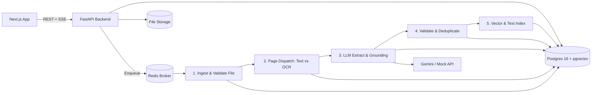

# Document Intelligence System

[](https://github.com/FaiazPronoy/document-intelligence-system/actions/workflows/ci.yml)
[](https://python.org)
[](https://fastapi.tiangolo.com)
[](https://nextjs.org)
[](https://www.postgresql.org/)
[](LICENSE)

**An automated financial document intelligence platform that extracts, validates, and reconciles invoices with evidence-grounded extraction.**

Reads digital and scanned PDFs (up to 1,000+ pages), multi-frame TIFFs, images, Excel workbooks, and CSV spreadsheets. Every extracted value is verified verbatim against its exact source line or purged. Suspect records are routed to an interactive human-in-the-loop review workstation with evidence bounding boxes highlighted on the original document.

| | |
|---|---|
| **Type** | Assessment Project |
| **Made by** | Faiaz Abrar Zaman Pronoy ([@FaiazPronoy](https://github.com/FaiazPronoy)) |
| **Stack** | Python 3.12 (FastAPI), Celery + Redis, PostgreSQL 16 (pgvector), Next.js 16 (React 19) |
| **Tests** | 179 passed in 56s, 100% green, 0 lint warnings |
| **Documentation** | [Architecture](docs/architecture.md) • [Database Schema](docs/schema.md) • [API Reference](docs/api.md) • [Evaluation Report](EVALUATION.md) • [Design Decisions](DECISIONS.md) • [Prompts](PROMPTS.md) |

| Review workstation | Ledger reconciliation |
|---|---|
|  |  |

| Hybrid search and discovery | System metrics and evaluation |
|---|---|
|  |  |

---

## Features

**Document Ingestion and Hybrid OCR**
- Accepts PDF (digital and scanned, 1,000+ pages), JPG, PNG, multi-frame TIFF, XLSX, XLS, and CSV files
- Decides text layer vs OCR page-by-page so clean digital pages process instantly without quality loss
- RapidOCR with ONNX runtime for fast text recognition, with automatic Tesseract fallback behind a unified interface
- Resilient ingestion: corrupt, encrypted, empty, oversized, macro-enabled, or zip-bomb files fail safely with clear error codes

**Evidence-Grounded AI Information Extraction**
- Extracts 9 core fields (invoice number, dates, supplier, customer, currency, subtotal, tax, total, po number) plus line items and tax lines
- Verbatim grounding: every value must match its quoted line id (e.g. `[P2:L14]`) on the page; unverified values are purged
- Untrusted document containment (`<untrusted_document>`) protects against prompt injection attacks
- Second-pass recovery prompt (`missing-v1`) targets missing mandatory fields before flagging for review

**Deterministic Validation and Business Rules**
- Full `Decimal` arithmetic: verifies line item totals, subtotal + tax = total, and tax rate plausibility
- Configurable tolerances in `config/validation.yaml` prevent false alarms on rounding differences
- 4-tier duplicate detection: identical file hash, same supplier + number + total, conflicting totals, and near-duplicate fuzzy matches
- Two-way reconciliation: matches invoices against spreadsheet ledger rows and highlights payment discrepancies

**Human-in-the-Loop Review Workstation**
- Visual document viewer displaying bounding boxes for extracted values and evidence quotes
- Live re-validation in the browser as reviewers correct fields
- Complete audit trail logging every manual edit, previous value, reviewer, and timestamp

**Enterprise Search and Scale**
- Hybrid search fusing PostgreSQL full-text search (`tsvector`) and 384-dimension semantic vector embeddings (RRF)
- Dedicated Celery worker queues (`worker` for fast tasks, `worker-heavy` for OCR) to prevent head-of-line blocking
- Automated self-healing sweeper recovers abandoned locks and interrupted background tasks

---

## Built with

| Part | Tools and Technologies |
|---|---|
| Backend API | FastAPI 0.162, Pydantic v2, SQLAlchemy 2.1, Uvicorn |
| Task Workers and Queue | Celery, Redis broker, Celery Beat scheduler |
| Database and Search | PostgreSQL 16, pgvector (vector search), pg_trgm (fuzzy match), full-text search |
| Document Ingestion | PyMuPDF (pymupdf), RapidOCR (ONNX runtime), Tesseract OCR fallback, Pillow |
| Spreadsheet Engine | openpyxl, pandas, python-calamine |
| AI and LLM Engine | Google Gemini API (gemini-3.5-flash-lite), Offline Mock Extractor |
| Frontend Interface | Next.js 16 (App Router), React 19, Tailwind CSS 4, Lucide React icons |
| Testing and Code Quality | Pytest, pytest-cov, ruff linter |

---

## Architecture and How it works



1. **Upload**: Checks magic bytes against extension, calculates SHA-256 hash. Re-uploading an existing hash returns the existing record immediately.
2. **Ingest**: Validates file integrity. Corrupted, encrypted, or oversized files fail with a clean error code without retries.
3. **Pages**: PyMuPDF checks each page for a digital text layer. If present, text and bounding boxes are extracted directly. If absent or sparse, the page renders to an image and runs OCR via RapidOCR (with Tesseract fallback). Large files fan out into Celery page batches with an atomic counter.
4. **Segment**: Multi-invoice PDFs split based on page layout signals (e.g. "Page 1 of 3", supplier change, balance due). Undecided boundaries use a targeted LLM call (`boundary-v1`).
5. **Extract**: Text lines become numbered references (`[P1:L14] Invoice # | INV-2024-001`). The model returns structured JSON with verbatim quotes and line identifiers. The post-processor verifies that the quote exists on the page; ungrounded values are set to null.
6. **Validate**: Deterministic rule engine checks mandatory fields, `Decimal` arithmetic tolerances, and duplicate tiers, routing records to `auto_validated` or `needs_review`.
7. **Index**: Generates weighted `tsvector` entries and 384-dimension vector embeddings for hybrid reciprocal-rank search.

Spreadsheets skip LLM calls for data rows: column headers are mapped once (via synonym dictionary or `columns-v1`), and all data rows are parsed directly in code.

---

## Measured Results (Mock Extractor Baseline)

All metrics below were measured on the actual benchmark dataset using `make eval`:

| Metric | Measured value | Scope / Details |
|---|---|---|
| Digital Macro F1 | **0.9839** | n = 126 digital invoices |
| All Key Fields Correct | **0.8016** | Supplier, number, date, total, currency |
| Hallucination Rate | **0.0000 / 0.0032** | 0.0 where truth is empty; 0.0032 for values not found in page text |
| Routing Recall | **0.9737** | 37/38 defective or planted invoices caught for review |
| Segmentation Accuracy | **1.0000** | 12/12 multi-invoice PDFs split correctly |
| Scan Macro F1 (Clean / Med / Heavy) | **0.9778 / 0.9914 / 0.6942** | Simulated scan degradations |
| Reconciliation Recall / Precision | **1.0000 / 0.7647** | Planted ledger discrepancies |
| Document Success Rate | **1.0000** | 237/237 documents completed without pipeline failure |

Full benchmark tables, dataset breakdown, comparison with Gemini baseline, and known limitations are documented in [EVALUATION.md](EVALUATION.md).

---

## Validation rules and tolerances

All rules and tolerances are defined declaratively in `backend/config/validation.yaml`:

| Rule Code | Target Checks | Configured Tolerance |
|---|---|---|
| `REQ_MISSING` / `OPT_MISSING` | Number, date, supplier, total, currency / customer, subtotal, tax | Mandatory vs optional |
| `LINE_MATH` | quantity * unit_price = amount | max($0.02, 0.05%); error above 1% |
| `SUBTOTAL_SUM` | Sum of line item amounts = subtotal | max($0.02, $0.01 per line) |
| `TOTAL_MATH` | subtotal - discount + shipping + tax = total | max($0.05, $0.01 per line) |
| `TAX_LINES` / `TAX_RATE` | Tax line breakdown sum, plausible tax rate | $0.02 tolerance |
| `DATE_SANITY` / `CURRENCY` | Future dates, pre-2000 dates, swapped DD/MM, missing currency | Format sanity |
| `LOW_CONFIDENCE` | Any key field confidence below 0.78, or read from image fallback | Review routing trigger |
| `GROUNDING_FAILED` | Value not found verbatim in source document | Critical finding |
| `DUP_INVOICE` / `DUP_CONFLICT` | Identical number and total / Same number, different total | Exact database match |
| `DUP_SUSPECTED` | Near-duplicate fuzzy match | Supplier similarity 0.85, dates +/- 3 days |
| `SUSPICIOUS_CONTENT` | Prompt-injection or instruction-like text inside document | Security quarantine |

An invoice is routed to `needs_review` on any critical finding, error code, duplicate match, failed page, or low-confidence key field.

---

## Quick start

### Prerequisites
- Docker Desktop with WSL 2 on Windows (or Docker on Linux/macOS)
- About 6 GB disk space for base images

### 1. Launch Services
```bash
# Copy environment variables (configured for offline mock extraction by default)
cp .env.example .env

# Start all containers (Postgres, Redis, API, Worker, Worker-Heavy, Beat, Web)
docker compose up -d --build

# Populate with demo invoices and spreadsheets
make seed
```

*On Windows without `make`, run: `docker compose run --rm api python -m scripts.seed_demo`*

### 2. Access Web Interface and API
- **Web Application**: [http://localhost:3000](http://localhost:3000)
- **Interactive API Documentation**: [http://localhost:8000/docs](http://localhost:8000/docs)
- **API Key**: `local-dev-key` (passed via `X-API-Key` header; supported via `?api_key=` on SSE and preview endpoints)

### 3. Using Gemini LLM
To switch from the offline mock to live Gemini extraction:
1. Set `LLM_PROVIDER=gemini` and `GEMINI_API_KEY=your_key_here` in `.env`.
2. Restart workers: `docker compose restart api worker worker-heavy`.
3. Total spend is capped by `LLM_BUDGET_USD` to prevent unexpected charges.

---

## Make commands

| Command | Action |
|---|---|
| `make up` / `make down` | Start or stop the complete container environment |
| `make seed` | Upload demo batch: clean PDFs, rotated scans, multi-invoice files, ledger workbooks |
| `make test` | Run unit and integration tests (writes to `backend/test-results/`) |
| `make eval` | Run benchmark runner and regenerate `EVALUATION.md` |
| `make bigpdf` | Generate 1,000-page digital and 100-page scanned benchmark PDFs |
| `make lint` | Run ruff code linter |

---

## Maintenance and Reliability

- **Background Sweeper**: Celery Beat runs `app.workers.tasks.sweep` every 5 minutes (or manual call to `POST /api/v1/maintenance/sweep?timeout_seconds=900`). It automatically reclaims stale finalizing leases, re-dispatches unhandled page chunks, and cleans up abandoned jobs.
- **Worker Isolation**: Memory-intensive OCR tasks execute in the dedicated `worker-heavy` container, preventing 1,000-page scans from delaying lightweight API or CSV tasks.
- **Horizontal Scaling**:
  - `docker compose up --scale worker=4 --scale worker-heavy=2` handles 10x document volume.
  - S3 / MinIO backend compatibility via `StorageService` for multi-terabyte storage.

---

## Known limitations

- Synthetic evaluation set: real supplier invoices have even more irregular layouts.
- Vision fallback values lack exact bounding boxes on the page preview.
- Semantic search uses a lightweight local embedding model; keyword search with metadata filters is recommended for production queries.
- Documents exceeding 10 pages extract header fields from the first and last two pages only.

---

## Licences

PyMuPDF is AGPL-3.0. Commercial deployments can switch to `pypdfium2`, isolated within `backend/app/pipeline/pdf.py`. All other dependencies are MIT, BSD, or Apache-2.0. Project license: [LICENSE](LICENSE).
