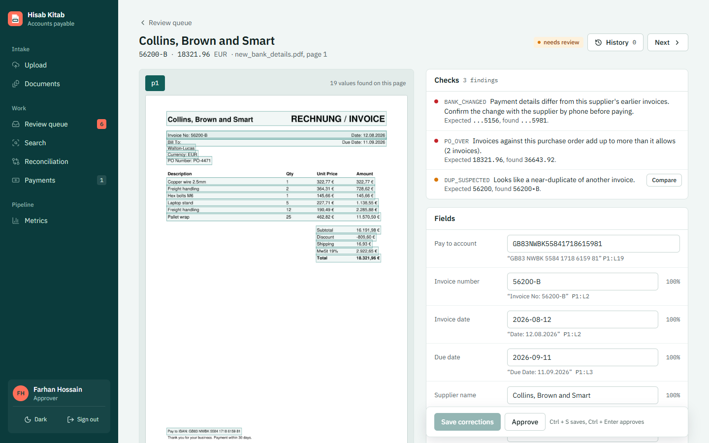
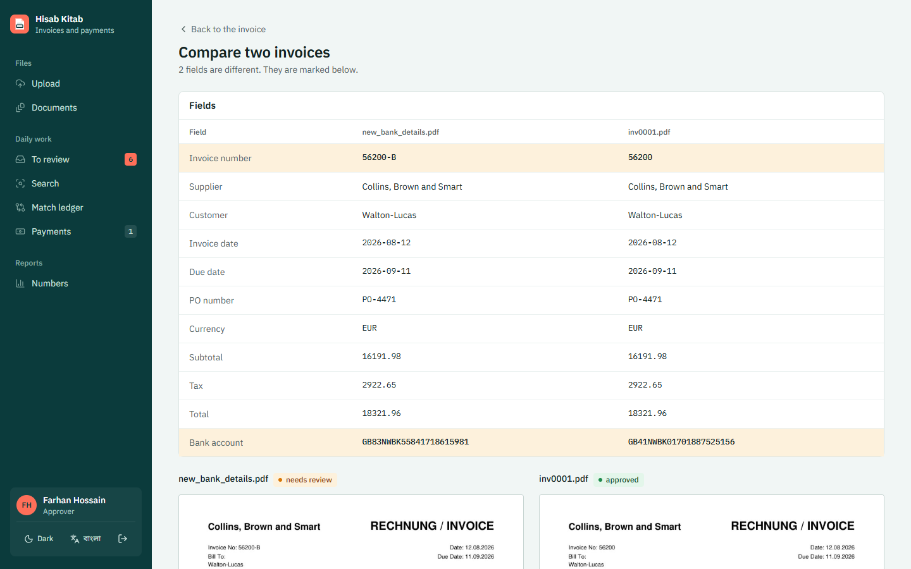
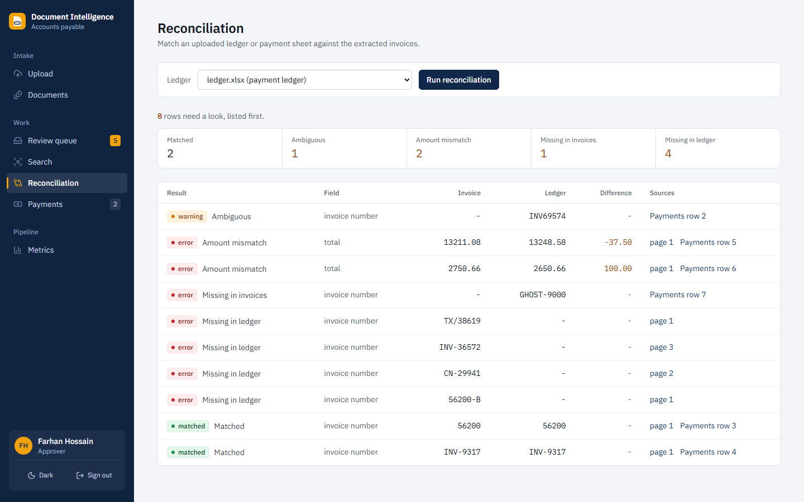
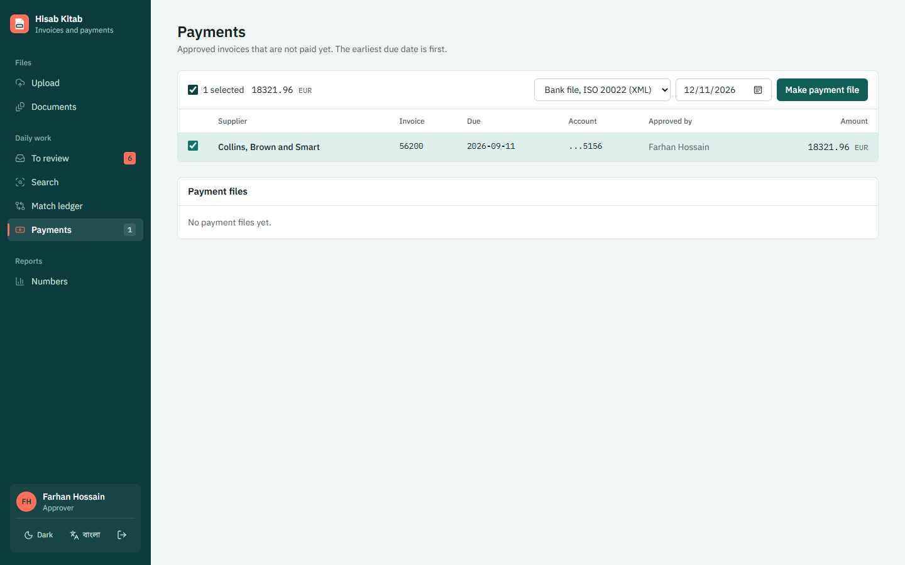
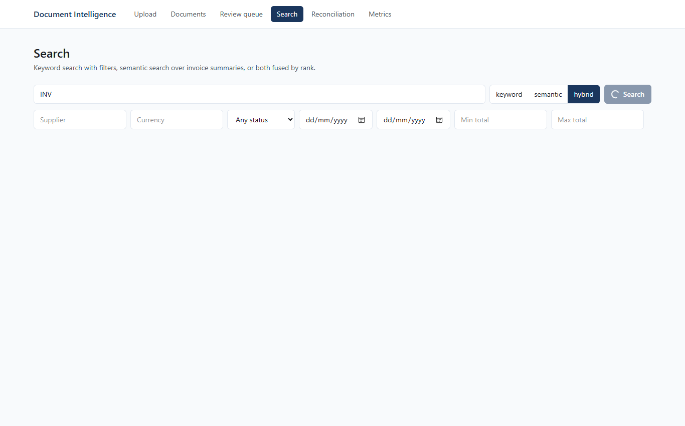
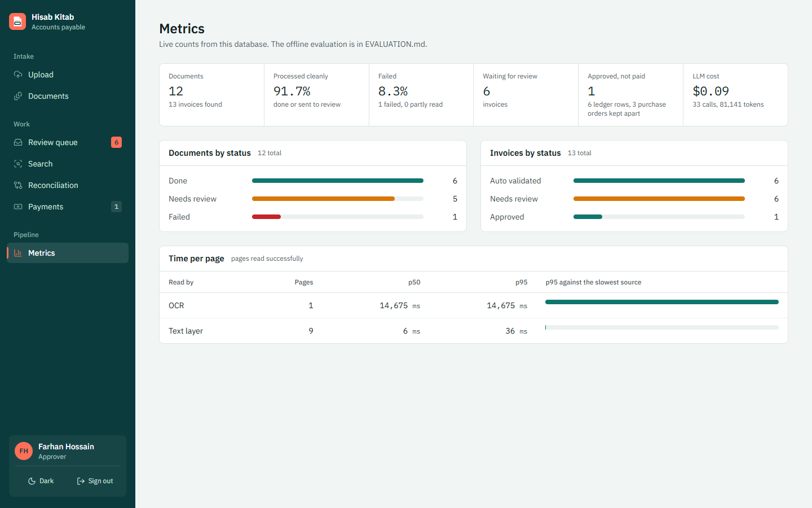
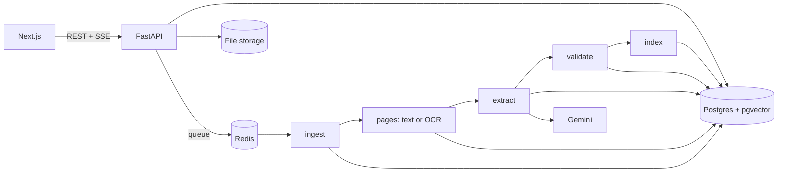

# Hisab Kitab (হিসাব কিতাব)

[](https://github.com/FaiazPronoy/Hisab-Kitab/actions/workflows/ci.yml)

**A document intelligence system for accounts payable: it reads invoices, receipts, scans and spreadsheets, checks them, sends anything doubtful to a reviewer and pays what is approved.**
Every extracted value points to the line it came from on the page. If the system cannot find a value in the document, it does not keep it.

| | |
|---|---|
| **Type** | Take-home project, solo (not for a course) |
| **Made by** | Faiaz Abrar Zaman Pronoy |
| **History** | Built in November 2026: the pipeline in five days, then reviewer roles, supplier memory and payments |
| **Docs** | [Architecture](docs/architecture.md), [Database schema](docs/schema.md), [API](docs/api.md), [Design decisions](DECISIONS.md), [Evaluation](EVALUATION.md), [Prompts](PROMPTS.md) |

| | |
|---|---|
|  |  |
|  |  |
|  |  |

---

## Features

**Reading documents**
- PDF (digital and scanned, tested at 1,000 pages), JPG, PNG, multi-frame TIFF, XLSX, XLS and CSV
- Each PDF page is checked on its own: a usable text layer is read directly, anything else goes to OCR
- OCR with RapidOCR, extra clean-up only when a page reads badly, Tesseract as a fallback
- Broken, encrypted, empty, oversized, macro and zip-bomb files fail at once with a clear error code

**Extracting invoices**
- Invoice number, dates, supplier, customer, PO number, currency, subtotal, tax, discount, shipping, total, line items and tax lines
- The model must quote the line each value came from; code checks that the quote and the number are really on the page
- Several invoices in one PDF are split into separate records
- Spreadsheets: ledger-style sheets are mapped once and every row is parsed in code, so a long sheet never goes to the LLM row by row
- A spreadsheet is a list of invoices, a payment ledger or a list of purchase orders, guessed from its headers or chosen on upload; ledger and PO rows are reference data, never reviewed
- IBANs (with their check digits) and labelled account numbers are read from the page, with the line they came from

**Checking the data**
- All money maths in `Decimal`: line totals, subtotal, tax and total, with tolerances in `backend/config/validation.yaml`
- Missing fields, odd dates, unclear currency and low confidence are flagged
- Four kinds of duplicate: same file, same invoice, same number with a different total, and near-duplicates such as `INV-1O8` for `INV-108`
- Invoices are matched against an uploaded ledger, and two copies of an invoice can be compared line by line
- Invoices are matched to uploaded purchase orders: the PO must exist, belong to the same supplier and currency, and not be billed beyond its amount across all its invoices
- Each supplier's approved history is a check of its own: changed bank details stop the invoice, and an amount far above the supplier's usual, a new currency or a first invoice are flagged

**Reviewing**
- The page image with the evidence box drawn on it, next to the extracted fields
- Fixing a value re-runs every check at once, and every change is kept in an audit log
- A review queue sorted by how serious the problems are
- Reviewers sign in. A clerk approves invoices under a limit; larger ones need an approver, and whoever changed the amounts on a large invoice cannot also approve it
- Supplier memory: when a reviewer fixes a field, the label printed before the value is remembered for that supplier and used on its next invoices. A value found this way still has to be on the page
- A suspected duplicate opens side by side with the invoice it resembles
- Light and dark themes, and layouts for phone, tablet and desktop

**Paying**
- Approved invoices become an ISO 20022 `pain.001` payment file or a CSV for bank upload
- An invoice in a payment file is locked, so it cannot be changed or paid twice

**Search and background work**
- Keyword, semantic and combined search with filters
- Background workers with per-page retries; a failed page does not stop the rest of the file, and only failed pages are re-run
- A separate worker for large scans, so a 1,000-page file does not hold up a one-page receipt

---

## Built with

| Part | Tools |
|---|---|
| API | Python 3.12, FastAPI, Pydantic, SQLAlchemy, Alembic |
| Background work | Celery with Redis |
| Database and search | PostgreSQL 16 with pgvector, pg_trgm and full-text search |
| PDF and OCR | PyMuPDF, RapidOCR (ONNX Runtime), Tesseract, OpenCV, Pillow |
| Spreadsheets | openpyxl, python-calamine, charset-normalizer |
| LLM | Google Gemini (Flash-Lite), or an offline rule-based extractor for runs without a key |
| Embeddings | fastembed with `BAAI/bge-small-en-v1.5`, run locally |
| Web app | Next.js, React, TypeScript, Tailwind CSS, TanStack Query |
| Tests | pytest against a real PostgreSQL, ruff |

---

## How it works



1. **Upload.** Size and type limits, a magic-byte check against the file extension, and a SHA-256 hash. The same file twice returns the first one.
2. **Ingest.** The file is opened and its pages counted. Problems with the file itself fail straight away and are never retried.
3. **Pages.** Large files are split into page batches. A page that fails three times is marked failed and the rest carry on.
4. **Split.** Multi-invoice PDFs are cut at "Page 1 of N", a new invoice number, a title at the top or a total at the bottom. Only unclear cases go to the LLM.
5. **Extract.** Lines are numbered (`[P3:L14] Total | 1,250.00`). One LLM call per invoice returns every field with its quote and line number. Code then removes any value it cannot find on the page.
6. **Validate.** Rules, duplicate checks and one routing function: `auto_validated` or `needs_review`.
7. **Index.** Full-text and a local embedding for search.

More detail in [docs/architecture.md](docs/architecture.md) and [DECISIONS.md](DECISIONS.md).

---

## Results

Measured with `make eval` on 180 generated invoices (126 in the scored test split), 45 simulated scans, 12 multi-invoice PDFs, a ledger with planted mismatches, six broken files, 30 invoices from six recurring suppliers and 40 real receipts from the public SROIE benchmark. Full tables in [EVALUATION.md](EVALUATION.md).

| Metric | Offline rule parser | Gemini 3.5 Flash-Lite |
|---|---|---|
| Field F1 on digital PDFs (macro) | 0.997 | 0.977 |
| Invoices with every key field right | 0.976 | 0.944 |
| Values given where the document has none | 0 | 0 |
| Wrong or planted invoices sent to review | 16 of 18 | 16 of 21 |
| Line item F1 | 0.922 | 0.967 |
| Multi-invoice PDFs split correctly | 12 of 12 | 12 of 12 |
| Documents processed without a pipeline failure | 1.000 | 0.979 |
| LLM cost for the whole run | $0 | $1.06 |
| Real receipts (SROIE, 40): company, date and total all right | 2 of 40 | 31 of 40 |

Cost is estimated from token counts at paid-tier prices. The run used the free AI Studio tier, so nothing was billed. In the Gemini run 5 of 237 documents failed because the Gemini service answered 503 (busy), and the eval does not retry. Those 5 count as misses in the Gemini column. Every wrong invoice Gemini did read (16 of 16) went to review. In the app, workers retry these errors with backoff.

Other measured results (offline parser unless a line says otherwise):

- Scans: field F1 0.99 on clean, 1.00 on medium and 0.71 on heavy degradation (15 each)
- Planted problems: 16 of 17 caught. The miss is a wrong total on an invoice with no subtotal line
- Ledger reconciliation: every planted mismatch, missing row and ambiguous row found
- Broken files (truncated, renamed, empty, encrypted, fake workbook, wrong type): 6 of 6 handled with the right error
- Supplier memory: six suppliers print their invoice number after a label the parser does not know. After one correction per supplier, the number was right on 24 of their next 24 invoices with memory on and 0 of 24 with it off; the reviewer fixed 6 numbers instead of 28
- Changed bank details: 2 of 2 planted IBAN changes stopped, no false alarm on 22 genuine invoices from the same suppliers
- Real receipts from the public SROIE benchmark (40 scans): Gemini got company 34, date 37 and total 39 right; the rule parser, which looks for printed labels, 15, 14 and 17

Large files, one worker with two processes:

| File | Pages | Time | Pages per minute | Peak worker memory |
|---|---|---|---|---|
| Digital PDF | 1,000 | 147.8 s | 405.9 | 373 MB |
| Scanned PDF | 100 | 838.9 s | 7.2 | 596 MB |

---

## Validation rules

| Rule | Checks | Tolerance |
|---|---|---|
| REQ_MISSING, OPT_MISSING | number, date, supplier, total and currency; customer, subtotal and tax | |
| LINE_MATH | quantity x unit price = amount | max(0.02, 0.05%), error above 1% |
| SUBTOTAL_SUM | line amounts add up to the subtotal | max(0.02, 0.01 per line) |
| TOTAL_MATH | subtotal - discount + shipping + tax = total | max(0.05, 0.01 per line) |
| TAX_LINES, TAX_RATE | tax lines add up, the rate is plausible | 0.02 |
| DATE_SANITY, CURRENCY | future or very old dates, day and month that could be swapped, a bare `$` | |
| LOW_CONFIDENCE | a key field below 0.78, or read from an image | |
| GROUNDING_FAILED | the value was not found in the document and was removed | |
| DUP_INVOICE, DUP_CONFLICT, DUP_SUSPECTED | same invoice; same number with another total; near-duplicate | supplier similarity 0.85, dates within 3 days |
| BANK_CHANGED | the IBAN or account differs from the supplier's approved invoices | |
| AMOUNT_OUTLIER, CURRENCY_CHANGED | over 3 times the supplier's median total; a currency the supplier never used | 3 earlier invoices |
| NEW_SUPPLIER | first invoice from a supplier, shown for information | |
| PO_UNKNOWN, PO_SUPPLIER, PO_CURRENCY | the cited purchase order is missing, for another supplier or in another currency | supplier similarity 85 |
| PO_OVER | all invoices citing a purchase order add up to more than it allows | 0.05 |
| SUSPICIOUS_CONTENT | instructions written inside the document | |

An invoice goes to review on any error, more than one warning, a missing or removed key field, a failed page, a duplicate or suspicious text.

---

## Demo logins

The sign in page has a one-tap button for each person.

| Role | Username | Password |
|---|---|---|
| Clerk | `nadia` | `demo-clerk` |
| Approver | `farhan` | `demo-approver` |

A clerk corrects invoices and approves those under 10,000. Larger invoices and changed bank details need the approver.

---

## Run it

You need **Docker Desktop** (with WSL 2 on Windows), about 6 GB of disk and 4 GB of memory for Docker.

- **Windows:** double-click `RUN-HisabKitab.bat`. It starts Docker if needed, writes `.env`, builds and starts the containers, loads the demo data and opens the app. The first run takes about 10 minutes.
- **By hand:**

```bash
cp .env.example .env
docker compose up -d --build
make seed
```

Open <http://localhost:3000>. API docs are at <http://localhost:8000/docs> (key `local-dev-key` in the `X-API-Key` header). Stop everything with `docker compose down`.

On Windows without `make`, run the command after the colon in the Makefile, for example `docker compose exec api python -m scripts.seed_demo`. More reviewers: `docker compose exec api python -m scripts.create_user <username> "<name>" clerk|approver <password>`.

| Command | What it does |
|---|---|
| `make seed` | creates the two demo reviewers and uploads a demo batch: clean PDF, rotated scan, broken PDF, three invoices in one PDF, a wrong total, a ledger, purchase orders, a CSV and an invoice with new bank details |
| `make test` | unit and integration tests |
| `make eval` | builds the dataset, runs it through the API and writes EVALUATION.md |
| `make bigpdf` | builds a 1,000-page digital PDF and a 100-page scan |
| `make lint` | ruff |

---

## Settings

Copy `.env.example` to `.env`. The `.env` file is never committed.

| Setting | What it is |
|---|---|
| `LLM_PROVIDER` | `mock` (default, no key needed) or `gemini` |
| `GEMINI_API_KEY` | needed only for `gemini`; a free key from Google AI Studio works |
| `LLM_MODEL`, `LLM_VISION_MODEL` | Gemini models for text and for the image fallback |
| `LLM_BUDGET_USD` | stops LLM calls once this much has been spent |
| `API_KEY` | key the web app and clients send in `X-API-Key` |
| `MAX_UPLOAD_MB`, `MAX_PAGES`, `MAX_SHEET_ROWS` | upload limits |
| `AUTH_SECRET` | signs reviewer sessions; set a long random value outside local use |
| `REQUIRE_LOGIN` | `true` by default; corrections, approvals and payment files need a signed-in reviewer |
| `APPROVAL_LIMIT` | invoices at or above this total need an approver (default 10000) |
| `SUPPLIER_MEMORY` | learn labels from corrections (default `true`) |
| `PAYER_NAME`, `PAYER_IBAN`, `PAYER_BIC` | the paying company written into `pain.001` files |

---

## Tests

- `make test` runs **201 tests** against a real PostgreSQL, with Celery tasks run inline
- They cover file checks, OCR fallbacks, spreadsheet parsing, extraction and grounding, every validation rule at its tolerance, duplicates, reconciliation, the API, corrections and audit, reprocessing failed pages, recovery of stuck jobs and broken LLM answers
- And the review side: sign-in and roles, the approval limit and four-eyes rule, supplier memory, changed bank details, ledger and invoice-list sheets, purchase order matching, and payment files checked against the pain.001 structure
- GitHub Actions runs the tests, ruff and the web build on every push

---

## Project structure

```
backend/
  app/api/           routes, auth, response shapes
  app/pipeline/      ingest, pdf, ocr, sheets, layout, segment, extract, validate, reconcile, index,
                     memory (supplier labels), payments (pain.001 and CSV)
  app/workers/       Celery app and tasks
  app/db/            models and migrations
  config/            validation.yaml
  tests/             unit and integration tests
eval/                dataset generator, scan simulator, runner, scorer, report
web/                 Next.js app
docs/                architecture, schema, API, screenshots
scripts/             demo seed, reviewer accounts, large-file benchmark
```

---

## Notes

- The main test set is generated, so real supplier invoices will be messier.
- Values read from a page image by the vision fallback have no box to highlight.
- Invoices longer than 10 pages take their header fields from the first and last two pages.
- Purchase order matching is two-way (invoice against PO). Goods receipts are not modelled, so it is not a full three-way match.
- PyMuPDF is AGPL-3.0. A closed deployment would need its commercial licence or a switch to `pypdfium2`, which `pipeline/pdf.py` keeps in one place.
- AI tools were used during development; see [AI_DISCLOSURE.md](AI_DISCLOSURE.md).

---

## Licence

Copyright 2026 Faiaz Abrar Zaman Pronoy. All rights reserved.
You may read the code and run it to evaluate it. You may not copy it, hand it in
as your own work, or publish it. See [LICENSE](LICENSE).
