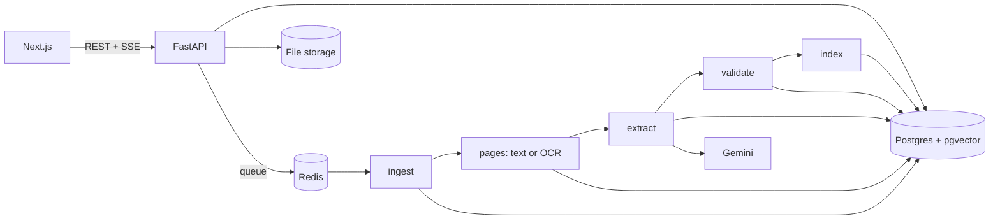

# Document Intelligence System

[](https://github.com/FaiazPronoy/document-intelligence-system/actions/workflows/ci.yml)

**Reads invoices, receipts, scans and spreadsheets, pulls out the invoice data, checks it and sends anything doubtful to a reviewer.**
Every extracted value points to the line it came from on the page. If the system cannot find a value in the document, it does not keep it.

| | |
|---|---|
| **Type** | Take-home project, built solo in five days |
| **Made by** | Faiaz Abrar Zaman Pronoy |
| **Built with** | Python, FastAPI, Celery, PostgreSQL with pgvector, Next.js |
| **Built in** | November 2026 |
| **Docs** | [Architecture](docs/architecture.md), [Database schema](docs/schema.md), [API](docs/api.md), [Design decisions](DECISIONS.md), [Evaluation](EVALUATION.md), [Prompts](PROMPTS.md) |

| | |
|---|---|
|  |  |
|  |  |

---

## Features

**Reading documents**
- PDF (digital and scanned, tested at 1,000 pages), JPG, PNG, multi-frame TIFF, XLSX, XLS and CSV
- Each PDF page is checked on its own: a usable text layer is read directly, anything else goes to OCR
- OCR with RapidOCR, extra clean-up only when a page reads badly, Tesseract as a fallback
- Broken, encrypted, empty, oversized, macro and zip-bomb files fail at once with a clear error code

**Extracting invoices**
- Invoice number, dates, supplier, customer, PO number, currency, subtotal, tax, discount, shipping, total, line items and tax lines
- The model must quote the line each value came from; code checks that the quote and the number are really on the page
- Several invoices in one PDF are split into separate records
- Spreadsheets: ledger-style sheets are mapped once and every row is parsed in code, so a long sheet never goes to the LLM row by row

**Checking the data**
- All money maths in `Decimal`: line totals, subtotal, tax and total, with tolerances in `backend/config/validation.yaml`
- Missing fields, odd dates, unclear currency and low confidence are flagged
- Four kinds of duplicate: same file, same invoice, same number with a different total, and near-duplicates such as `INV-1O8` for `INV-108`
- Invoices are matched against an uploaded ledger, and two copies of an invoice can be compared line by line

**Reviewing**
- The page image with the evidence box drawn on it, next to the extracted fields
- Fixing a value re-runs every check at once, and every change is kept in an audit log
- A review queue sorted by how serious the problems are

**Search and background work**
- Keyword, semantic and combined search with filters
- Background workers with per-page retries; a failed page does not stop the rest of the file, and only failed pages are re-run
- A separate worker for large scans, so a 1,000-page file does not hold up a one-page receipt

---

## Built with

| Part | Tools |
|---|---|
| API | Python 3.12, FastAPI, Pydantic, SQLAlchemy, Alembic |
| Background work | Celery with Redis |
| Database and search | PostgreSQL 16 with pgvector, pg_trgm and full-text search |
| PDF and OCR | PyMuPDF, RapidOCR (ONNX Runtime), Tesseract, OpenCV, Pillow |
| Spreadsheets | openpyxl, python-calamine, charset-normalizer |
| LLM | Google Gemini (Flash-Lite), or an offline rule-based extractor for runs without a key |
| Embeddings | fastembed with `BAAI/bge-small-en-v1.5`, run locally |
| Web app | Next.js, React, TypeScript, Tailwind CSS, TanStack Query |
| Tests | pytest against a real PostgreSQL, ruff |

---

## How it works



1. **Upload.** Size and type limits, a magic-byte check against the file extension, and a SHA-256 hash. The same file twice returns the first one.
2. **Ingest.** The file is opened and its pages counted. Problems with the file itself fail straight away and are never retried.
3. **Pages.** Large files are split into page batches. A page that fails three times is marked failed and the rest carry on.
4. **Split.** Multi-invoice PDFs are cut at "Page 1 of N", a new invoice number, a title at the top or a total at the bottom. Only unclear cases go to the LLM.
5. **Extract.** Lines are numbered (`[P3:L14] Total | 1,250.00`). One LLM call per invoice returns every field with its quote and line number. Code then removes any value it cannot find on the page.
6. **Validate.** Rules, duplicate checks and one routing function: `auto_validated` or `needs_review`.
7. **Index.** Full-text and a local embedding for search.

More detail in [docs/architecture.md](docs/architecture.md) and [DECISIONS.md](DECISIONS.md).

---

## Results

Measured with `make eval` on 180 generated invoices (126 in the scored test split), 45 simulated scans, 12 multi-invoice PDFs, a ledger with planted mismatches and six broken files. Full tables in [EVALUATION.md](EVALUATION.md).

| Metric | Offline rule parser | Gemini Flash-Lite |
|---|---|---|
| Field F1 on digital PDFs (macro) | 0.997 | 0.999 |
| Invoices with every key field right | 0.976 | 0.992 |
| Values given where the document has none | 0 | 0 |
| Wrong or planted invoices sent to review | 16 of 18 | all |
| Line item F1 | 0.922 | 1.000 |
| Multi-invoice PDFs split correctly | 12 of 12 | 12 of 12 |
| Documents processed without a pipeline failure | 1.000 | 0.928 |
| LLM cost for the whole run | $0 | $0.99 |

The Gemini column is from an earlier run on the same data, before the last fixes. Other measured results with the offline parser:

- Scans: field F1 0.99 on clean, 1.00 on medium and 0.71 on heavy degradation (15 each)
- Planted problems (wrong totals, missing tax or number, duplicates, conflicting duplicates): all caught
- Ledger reconciliation: every planted mismatch, missing row and ambiguous row found
- Broken files (truncated, renamed, empty, encrypted, fake workbook, wrong type): 6 of 6 handled with the right error

Large files, one worker with two processes:

| File | Pages | Time | Pages per minute | Peak worker memory |
|---|---|---|---|---|
| Digital PDF | 1,000 | 147.8 s | 405.9 | 373 MB |
| Scanned PDF | 100 | 838.9 s | 7.2 | 596 MB |

---

## Validation rules

| Rule | Checks | Tolerance |
|---|---|---|
| REQ_MISSING, OPT_MISSING | number, date, supplier, total and currency; customer, subtotal and tax | |
| LINE_MATH | quantity x unit price = amount | max(0.02, 0.05%), error above 1% |
| SUBTOTAL_SUM | line amounts add up to the subtotal | max(0.02, 0.01 per line) |
| TOTAL_MATH | subtotal - discount + shipping + tax = total | max(0.05, 0.01 per line) |
| TAX_LINES, TAX_RATE | tax lines add up, the rate is plausible | 0.02 |
| DATE_SANITY, CURRENCY | future or very old dates, day and month that could be swapped, a bare `$` | |
| LOW_CONFIDENCE | a key field below 0.78, or read from an image | |
| GROUNDING_FAILED | the value was not found in the document and was removed | |
| DUP_INVOICE, DUP_CONFLICT, DUP_SUSPECTED | same invoice; same number with another total; near-duplicate | supplier similarity 0.85, dates within 3 days |
| SUSPICIOUS_CONTENT | instructions written inside the document | |

An invoice goes to review on any error, more than one warning, a missing or removed key field, a failed page, a duplicate or suspicious text.

---

## Run it

Needs Docker Desktop (WSL 2 on Windows) and about 6 GB of disk.

```bash
cp .env.example .env
docker compose up -d --build
make seed
```

- Web app: http://localhost:3000
- API docs: http://localhost:8000/docs (key `local-dev-key` in the `X-API-Key` header)

On Windows without `make`, run the command after the colon in the Makefile, for example `docker compose run --rm api python -m scripts.seed_demo`.

| Command | What it does |
|---|---|
| `make seed` | uploads a demo batch: clean PDF, rotated scan, broken PDF, three invoices in one PDF, a wrong total, a ledger and a CSV |
| `make test` | unit and integration tests |
| `make eval` | builds the dataset, runs it through the API and writes EVALUATION.md |
| `make bigpdf` | builds a 1,000-page digital PDF and a 100-page scan |
| `make lint` | ruff |

---

## Settings

Copy `.env.example` to `.env`. The `.env` file is never committed.

| Setting | What it is |
|---|---|
| `LLM_PROVIDER` | `mock` (default, no key needed) or `gemini` |
| `GEMINI_API_KEY` | needed only for `gemini`; a free key from Google AI Studio works |
| `LLM_MODEL`, `LLM_VISION_MODEL` | Gemini models for text and for the image fallback |
| `LLM_BUDGET_USD` | stops LLM calls once this much has been spent |
| `API_KEY` | key the web app and clients send in `X-API-Key` |
| `MAX_UPLOAD_MB`, `MAX_PAGES`, `MAX_SHEET_ROWS` | upload limits |

---

## Tests

- `make test` runs **185 tests** against a real PostgreSQL, with Celery tasks run inline
- They cover file checks, OCR fallbacks, spreadsheet parsing, extraction and grounding, every validation rule at its tolerance, duplicates, reconciliation, the API, corrections and audit, reprocessing failed pages, recovery of stuck jobs and broken LLM answers
- GitHub Actions runs the tests, ruff and the web build on every push

---

## Project structure

```
backend/
  app/api/           routes, auth, response shapes
  app/pipeline/      ingest, pdf, ocr, sheets, layout, segment, extract, validate, reconcile, index
  app/workers/       Celery app and tasks
  app/db/            models and migrations
  config/            validation.yaml
  tests/             unit and integration tests
eval/                dataset generator, scan simulator, runner, scorer, report
web/                 Next.js app
docs/                architecture, schema, API, screenshots
scripts/             demo seed, large-file benchmark
```

---

## Notes

- The main test set is generated, so real supplier invoices will be messier.
- Values read from a page image by the vision fallback have no box to highlight.
- Invoices longer than 10 pages take their header fields from the first and last two pages.
- PyMuPDF is AGPL-3.0. A closed deployment would need its commercial licence or a switch to `pypdfium2`, which `pipeline/pdf.py` keeps in one place.
- AI tools were used during development; see [AI_DISCLOSURE.md](AI_DISCLOSURE.md).

---

## Licence

Copyright 2026 Faiaz Abrar Zaman Pronoy. All rights reserved.
You may read the code and run it to evaluate it. You may not copy it, hand it in
as your own work, or publish it. See [LICENSE](LICENSE).
