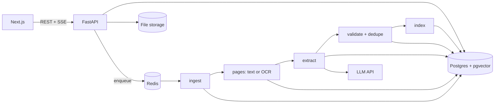

# Document Intelligence System

Reads invoices, receipts, scans and spreadsheets, extracts structured invoice data, checks it, and puts the doubtful records in front of a reviewer with the evidence highlighted on the page. Every extracted value is traceable to the line it came from, or it is not kept.

- PDF (digital and scanned, 1,000+ pages), JPG, PNG, multi-frame TIFF, XLSX, XLS and CSV
- Text layer where the page has one, OCR where it does not, decided page by page
- LLM extraction that has to quote its source; code removes any value it cannot find in the document
- Validation in Python with `Decimal`: maths, missing fields, dates, currency, four tiers of duplicates
- Review workstation: page image with the evidence box, live re-validation after a correction, full audit trail
- Keyword, semantic and hybrid search; reconciliation of invoices against a ledger spreadsheet
- Background processing with per-page retries, partial failure and reprocessing of only what failed
- Measured evaluation on a generated, labelled dataset: `make eval` writes [EVALUATION.md](EVALUATION.md)

## Quick start

Needs Docker Desktop (WSL 2 on Windows) and about 6 GB of disk for the images.

```bash
cp .env.example .env          # works as is with the offline mock extractor
docker compose up -d --build  # postgres, redis, api, worker, web
make seed                     # uploads a demo batch
```

Open http://localhost:3000 for the web app and http://localhost:8000/docs for the API. The default API key is `local-dev-key`.

To use Gemini instead of the offline mock, set `LLM_PROVIDER=gemini` and `GEMINI_API_KEY` in `.env` and restart `api` and `worker`. Spend is capped by `LLM_BUDGET_USD`.

Without `make` (plain Windows), the targets are one-liners: `docker compose run --rm api pytest -q`, `docker compose run --rm api python -m eval.runner`, `docker compose run --rm api python -m scripts.seed_demo`.

| Command | What it does |
| --- | --- |
| `make up` / `make down` | start or stop everything |
| `make seed` | demo batch: clean PDF, rotated TIFF scan, corrupted PDF, three invoices in one PDF, a wrong total, a ledger workbook and a semicolon CSV |
| `make test` | unit and integration tests against a real PostgreSQL, results in `backend/test-results/` |
| `make eval` | builds the dataset, runs it through the API, writes `EVALUATION.md` |
| `make bigpdf` | builds a 1,000-page digital PDF and a 100-page scanned PDF |
| `make lint` | ruff |

## Results

| Metric | Measured value | Note |
|---|---|---|
| Digital macro F1 | 0.999 | n = 126 digital invoices |
| All key fields correct | 0.9921 | supplier, number, date, total, currency |
| Hallucination rate | 0.0 | ungrounded values removed by code |
| Routing recall | 1.0 | 17/17 planted errors sent to review |
| Segmentation accuracy | 1.0 | 12/12 multi-invoice PDFs split correctly |
| Scan macro F1 (clean / medium / heavy) | 0.919 / 1.0 / 0.805 | degraded simulated scans |
| Reconciliation recall / precision | 1.0 / 0.8125 | planted ledger discrepancies |
| Document success rate | 0.9283 | 237 documents (corrupt files rejected cleanly) |
| 1,000-page digital PDF (1 worker) | 34.2 pages/min | 1755.1 s wall time, peak worker RSS 130 MB |
| 1,000-page digital PDF (2 workers) | 654.3 pages/min | 91.7 s wall time, peak worker RSS 559 MB |
| 100-page scanned PDF (1 worker) | 6.3 pages/min | 946.7 s wall time, peak worker RSS 781 MB |

Full tables, the dataset composition and the limitations are in [EVALUATION.md](EVALUATION.md). Numbers come from one run on one machine; nothing here is extrapolated.

## Screenshots

| Review workstation | Reconciliation |
|---|---|
|  |  |

| Search | Metrics |
|---|---|
|  |  |

## How it works



1. **Upload.** Size, count and type limits, magic-byte check against the extension, SHA-256. The same file twice returns the existing document.
2. **Ingest.** Corrupt, encrypted, empty, oversized, macro-enabled and zip-bomb files fail at once with an `error_code` and are never retried.
3. **Pages.** Each PDF page is classified: a usable text layer is read directly with word boxes; otherwise the page is rendered and OCR'd (RapidOCR, conditional preprocessing only when confidence is low, Tesseract as fallback). Large files fan out into page ranges; an atomic counter starts the next stage when the last page finishes. A page that fails three times is marked failed and the document ends as `completed_with_errors`.
4. **Segment.** Multi-invoice PDFs are split from page signals ("Page 1 of 3", invoice number changes, titles, totals at the bottom); only undecided boundaries are asked of the LLM.
5. **Extract.** Words become numbered lines (`[P3:L14] Total | 1,250.00`). One LLM call per invoice returns every field with a verbatim quote and the line id. Code then checks the quote is on the page and the value is in the quote; numbers must appear exactly. Anything that fails becomes null with reason `unverified`.
6. **Validate.** Rules from `backend/config/validation.yaml`, duplicate checks, one routing function: `needs_review` or `auto_validated`.
7. **Index.** Weighted `tsvector` and a local 384-dimension embedding for hybrid search.

Spreadsheets skip the LLM for rows: register sheets are mapped once (synonyms, then at most one LLM call with sample rows) and every row is parsed in code; form-style sheets go through normal extraction as cell lines.

More: [docs/architecture.md](docs/architecture.md), [docs/schema.md](docs/schema.md), [docs/api.md](docs/api.md), [DECISIONS.md](DECISIONS.md), [PROMPTS.md](PROMPTS.md).

## Validation rules and tolerances

| Rule | Checks | Tolerance |
| --- | --- | --- |
| REQ_MISSING / OPT_MISSING | number, date, supplier, total, currency / customer, subtotal, tax | |
| LINE_MATH | quantity x unit price = amount | max(0.02, 0.05%); error above 1% |
| SUBTOTAL_SUM | line amounts add up to the subtotal | max(0.02, 0.01 per line) |
| TOTAL_MATH | subtotal - discount + shipping + tax = total | max(0.05, 0.01 per line) |
| TAX_LINES, TAX_RATE, TAX_INCLUSIVE | tax lines sum, plausible rate, tax-inclusive totals (info only) | 0.02 |
| DATE_SANITY, CURRENCY, AMOUNT_SANITY | future or pre-2000 dates, swapped day and month, bare `$`, negative totals that are not credit notes | |
| LOW_CONFIDENCE | key field below 0.78, or read from an image | |
| GROUNDING_FAILED | the value was not found in the document and was removed | critical |
| DUP_INVOICE / DUP_CONFLICT / DUP_SUSPECTED | same number and total / same number, different total / near-duplicate or OCR variant | supplier similarity 0.85, dates within 3 days |
| SUSPICIOUS_CONTENT | instruction-like text inside the document | |

An invoice goes to review on any error or critical finding, more than one warning, a missing or unverified key field, a failed page, a duplicate or suspicious content.

## Cost

Extraction uses Gemini Flash-Lite with structured JSON-schema output ($0.25-$0.30 per million input tokens, $1.00-$2.50 per million output tokens). A one-page invoice is one call plus, only when a key field is missing, one short follow-up. Calls are cached by prompt version, model and input, so re-running the evaluation is free. Measured tokens and cost per run are in EVALUATION.md and on the Metrics page.

## Scaling

- **10x:** more workers (`docker compose up --scale worker=4`), the separate `ocr_heavy` queue keeps big scans from blocking small files, a connection pooler in front of Postgres.
- **100x:** object storage (S3 or MinIO behind the existing `StorageService`), autoscaling workers on queue depth, managed Postgres with a read replica for search, embeddings in a batch job, LLM calls through a provider with higher rate limits.

## Production hardening (not built)

S3 with KMS, role-based access and tenants, SSO, ClamAV on uploads, sandboxed workers for untrusted files, retention policy, tracing and alerting. The API key is a stand-in for real authentication; the JWT design would carry tenant and role claims checked in the same dependency.

## Known limitations

- The main evaluation set is synthetic; real supplier layouts are messier.
- Values read by the vision fallback have no box on the page.
- Semantic search uses a small local model; keyword search with filters is the main tool.
- Invoices longer than 10 pages read header fields from the first and last two pages only and are flagged.

## Licences

PyMuPDF is AGPL-3.0. Shipping this as a closed service would need a commercial PyMuPDF licence or a switch to `pypdfium2`, which the `pdf.py` module isolates. Other dependencies are MIT, BSD or Apache-2.0. Project licence: [LICENSE](LICENSE).
