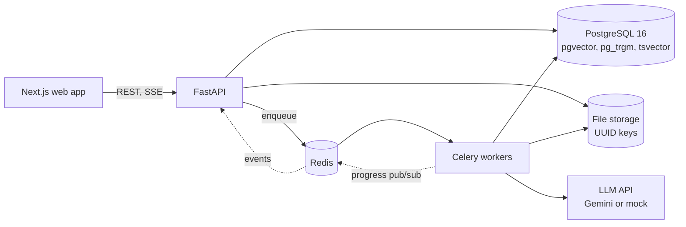
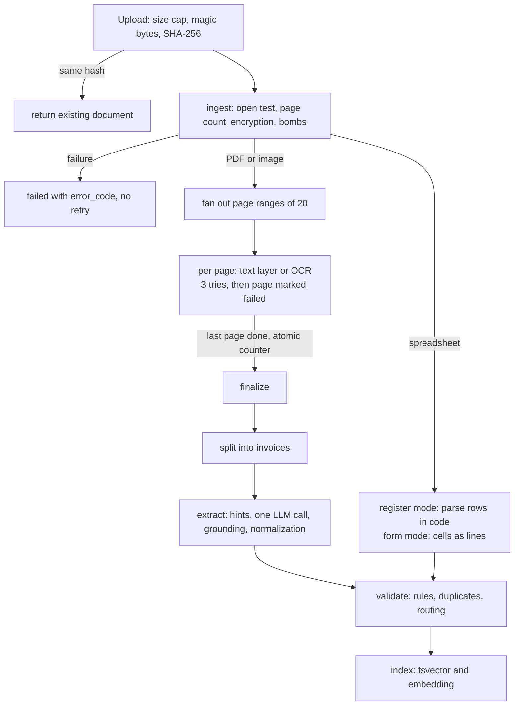
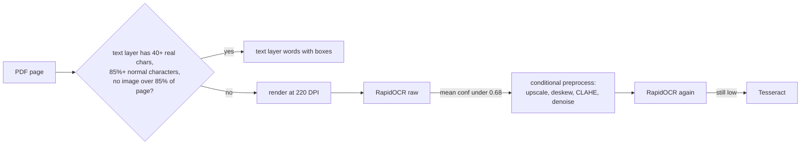
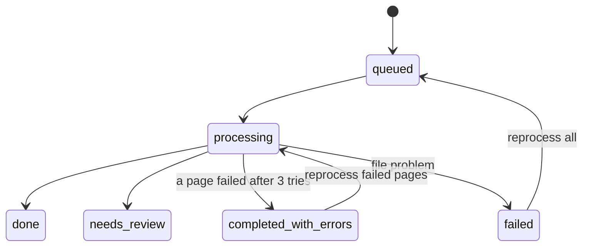
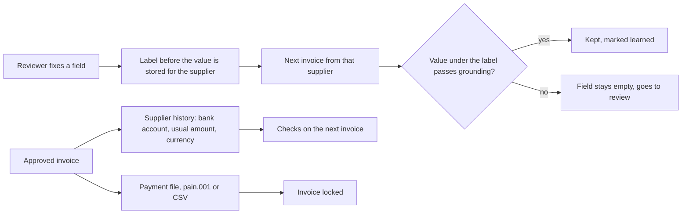

# Architecture

## Components

`api` and `worker` are the same image with different commands. Workers are stateless; `docker compose up --scale worker=4` adds capacity.

## Pipeline

Queues: `ingest`, `ocr`, `ocr_heavy` (scans over 60 pages), `extract`, `index`.

## Per page decision

## Status models

Invoice: `extracted` then `auto_validated` or `needs_review`, then `approved` by a reviewer. A correction to an approved invoice sends it back to `needs_review` until approved again; once it is in a payment file it cannot be changed. Rows of a payment ledger get `ledger` and are never reviewed.

Job: `queued`, `running`, `succeeded` or `failed`. Transient errors (LLM 429 and 5xx, timeouts, network) retry with exponential backoff and jitter up to 3 times; failures are kept in `failed_tasks`.

## After review

A clerk approves under `APPROVAL_LIMIT`; an approver is needed above it, and not the same person who changed the amounts. Ledger spreadsheets skip this path entirely: their rows only feed reconciliation.
