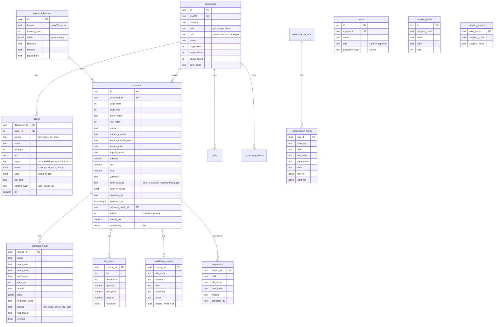

# Database schema

PostgreSQL 16 with the `vector` and `pg_trgm` extensions. Money is `NUMERIC(18,4)`; ids are UUIDs.

Also `jobs`, `processing_events` (stage timeline per document and page), `failed_tasks` (dead letters) and `llm_calls` (prompt version, model, input hash, tokens, cost, latency, cached structured answer; no document text).

## Indexes

- `documents.sha256` unique (idempotent uploads)
- `invoices (supplier_norm, invoice_number_norm)` for duplicate lookups
- partial index on `invoices.created_at WHERE status = 'needs_review'` for the review queue
- GIN on `invoices.search_tsv` and `pages.tsv`
- trigram GIN on `supplier_norm` and `invoice_number_norm`
- HNSW (`vector_cosine_ops`) on `invoices.embedding`
